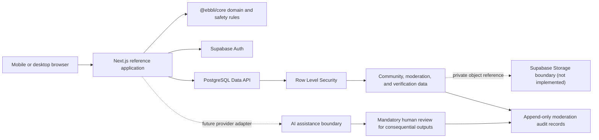

# Ebbli Community OS

**Reusable, trusted, mobile-first community infrastructure designed first for African
contexts and adaptable globally.**


> **Maturity notice:** This repository is an early-alpha, pre-release reference
> implementation. Database and domain foundations for Phases 1–4 are implemented and have
> been locally exercised; end-user workflows remain minimal, independent security review is
> pending, and no production-readiness claim is made.

## Why this exists

Community organizations repeatedly rebuild identity, membership, needs and opportunity
boards, events, moderation, verification, evidence handling, and audit systems. Ebbli aims
to turn those common concerns into reusable open-source infrastructure with explicit trust
boundaries.

It is intended for nonprofits, schools, churches, alumni networks, civic groups, community
ventures, and developers building for mobile-only users, intermittent connectivity,
localization needs, and community-led trust.

African operating constraints lead to broadly useful engineering choices: small core
workflows, low-bandwidth interfaces, provider boundaries, human moderation, explainable
verification, and data minimization.

## What exists today

- A pnpm/Turborepo workspace with a Next.js 16 reference application.
- A reusable TypeScript core package with trust and deterministic AI-safety contracts.
- Supabase Auth/PostgreSQL migrations for profiles, communities, memberships, needs,
  opportunities, evidence metadata, events, attendance, comments, notifications, reports,
  moderation audit records, verification, trust summaries, appeals, and AI audit records.
- Row Level Security policies and pgTAP tests for critical ownership and review boundaries.
- CI for formatting, migration naming, lint, type checking, unit tests, production build,
  clean database reset, database tests, database linting, dependency review, and CodeQL.
- Public contribution, governance, security, release, pilot, and responsible-AI guidance.

The schema/domain layer is substantially ahead of the UI. The web application currently
demonstrates project positioning, not complete community workflows. See the
[feature-status matrix](docs/FEATURE_STATUS.md).

## Not implemented or not yet proven

- A complete authentication and community-management UI.
- Evidence file uploads, private Storage policies, malware scanning, or retention automation.
- Delivery providers for email, messaging, and notifications.
- Production AI-provider integration.
- Offline synchronization, localization bundles, or measured low-bandwidth targets.
- A public reference deployment, independent security review, or verified outside adoption.

## Architecture



Provider integrations are intentionally bounded so deployments can replace Supabase,
notification, storage, or AI providers where practical. Production Ebbli data, proprietary
matching logic, payments, and private anti-abuse signals are outside this repository.

## Quick start

Prerequisites: Node.js 20 LTS, Corepack with pnpm 10.13.1, Docker Desktop, and Git.

```bash
git clone https://github.com/benkiruthi/ebbli-community-os.git
cd ebbli-community-os
corepack enable
corepack prepare pnpm@10.13.1 --activate
pnpm install --frozen-lockfile
cp .env.example apps/web/.env.local
pnpm db:start
pnpm db:reset
pnpm dev
```

Supabase prints the local API URL and anonymous key. Add only those public local values to
`apps/web/.env.local`. Never expose a service-role key to browser code. Windows users should
read [validation and troubleshooting](docs/VALIDATION.md).

## Validate

```bash
pnpm format:check
pnpm migration:check
pnpm lint
pnpm typecheck
pnpm test
pnpm build --force
pnpm db:reset
pnpm test:db
```

Passing these commands means the checked revision passed defined automated gates. It does
not mean the project is production-ready or independently audited.

## Security model

Every application table in the exposed `public` schema enables RLS. Policies use ownership,
membership, and moderator checks; workflow-integrity triggers protect immutable ownership
and reviewer-controlled fields. Privileged database functions have explicit execution
grants. Evidence is metadata-only until private Storage policies are implemented.

Read [SECURITY.md](SECURITY.md) and the [threat model](docs/THREAT_MODEL.md). Do not report
vulnerabilities in public issues.

## Responsible AI

AI may assist with navigation, drafting, translation, summarization, and categorization.
It must not make final verification, moderation, eligibility, financial-support, or safety
decisions. High- and critical-risk outputs require meaningful human review and auditable
metadata. See [Responsible AI](docs/RESPONSIBLE_AI.md).

## Mobile, bandwidth, localization, and accessibility

These are design requirements, not completed claims. Contributions should work with
keyboard and screen readers, avoid unnecessary media, preserve usable small-screen flows,
support localization, and document performance impact. Benchmarks and independent reviews
remain planned.

## Project documentation

- [Feature status](docs/FEATURE_STATUS.md)
- [Architecture](docs/ARCHITECTURE.md)
- [Vision](docs/VISION.md)
- [Validation](docs/VALIDATION.md)
- [Threat model](docs/THREAT_MODEL.md)
- [Roadmap](ROADMAP.md)
- [Reviewer guide](docs/REVIEWER_GUIDE.md)
- [Adoption status](docs/ADOPTION.md)
- [Governance](docs/GOVERNANCE.md)
- [Release process](docs/RELEASE_PROCESS.md)

## Contributing and support

Start with [CONTRIBUTING.md](CONTRIBUTING.md), follow the
[Code of Conduct](CODE_OF_CONDUCT.md), and use an issue before substantial work.
Best-effort support boundaries are documented in [SUPPORT.md](SUPPORT.md).

## Current limitations

The project has one primary maintainer, no stable release, no public reference deployment,
no verified external users, and no independent security or accessibility review. Pilot
evaluations should use synthetic data and follow [PILOT_GUIDE.md](docs/PILOT_GUIDE.md).

## License and maintainer

Licensed under the [Apache License 2.0](LICENSE). Initiated and maintained by
[Ben Kiruthi](https://github.com/benkiruthi), Nairobi, Kenya. Maintainer responsibilities
and the pathway for trusted contributors are in [MAINTAINERS.md](docs/MAINTAINERS.md).
