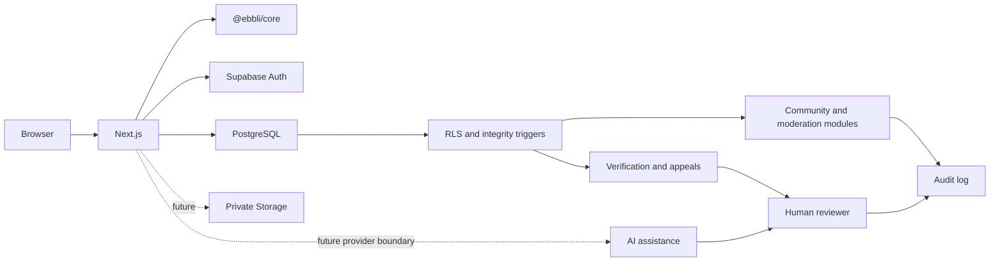

# Architecture Principles

## Goals

The architecture should be modular, secure by default, mobile-first, testable, and usable by organizations with limited technical teams.

## Current shape

```text
apps/web/             Minimal Next.js reference application
packages/core/        Trust contracts and deterministic AI-safety rules
supabase/migrations/  Auth, community, moderation, verification, and AI audit schema
supabase/tests/       pgTAP RLS and workflow-integrity tests
```

## Target shape

```text
apps/
  web/                 Reference community application
packages/
  auth/                Authentication and identity helpers
  communities/         Communities and memberships
  needs-opportunities/ Needs, opportunities, evidence and approval
  events/              Event workflows
  moderation/          Reports, reviews and audit trails
  notifications/       Provider-independent notification interfaces
  ai/                  Responsible AI interfaces and safeguards
  ui/                  Accessible mobile-first components
supabase/
  migrations/          Database migrations
  seed/                Safe demonstration data
docs/                   Product and technical documentation
```

This is a target structure, not yet an implemented API contract.



## Core boundaries

### Open-source foundation

The repository may include reusable schemas, interfaces, components, policies, examples, and reference workflows.

### Private product layer

Production Ebbli data, credentials, private analytics, payment configuration, anti-abuse signals, and proprietary commercial algorithms must remain outside the repository.

## Data and authorization

- PostgreSQL is the proposed source of truth.
- Supabase may provide authentication, database access, storage, and realtime features.
- Row Level Security must be enabled and tested for user-owned or community-restricted data.
- Service-role credentials must never reach client code.
- Evidence attachments and sensitive documents require explicit access rules and retention policies.
- Moderation decisions should have auditable state transitions.

## Application design

- Server-side authorization must not depend only on hidden interface elements.
- Features should degrade gracefully on slow connections.
- Core flows should work without large media downloads.
- Interfaces should be accessible and localization-ready.
- Provider integrations should be wrapped behind interfaces where practical.

## AI design

AI modules should suggest, summarize, classify, or guide within defined boundaries. High-impact decisions such as approving financial needs, verifying identity, banning members, or deciding eligibility must retain meaningful human review.

## Decision records

Significant architectural decisions should eventually be captured as Architecture Decision Records in `docs/adr/`.

Provider boundaries reduce lock-in: application code should depend on domain interfaces
rather than provider-specific identifiers where practical. The commercial Ebbli product,
production data, payments, proprietary matching/anti-abuse logic, and private analytics
remain intentionally outside this repository.
